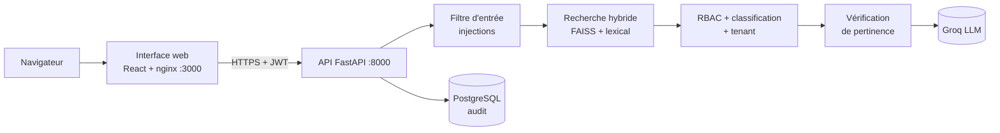

# Fluxa : assistant documentaire IA sécurisé (RAG)


[](LICENSE)

Fluxa répond aux questions des collaborateurs d'une entreprise à partir de ses propres
documents, **en respectant qui a le droit de voir quoi**. Chaque réponse cite ses sources,
chaque accès est tracé, et une question hors périmètre ou malveillante est refusée plutôt
qu'inventée.

> Conçu et développé par **[Houda Mardas](#auteure)**, AI Engineer, pendant son stage chez
> Alexsys Solutions (Casablanca, 2026).

## Résultats clés

| | |
|---|---|
| Corpus indexé | ~3 000 passages, réponses avec citation des sources |
| Évaluation sur le vrai pipeline | 55 cas, 100 % de réussite ([détail](backend/docs/EVALUATION.md)) |
| Injections de prompt | 9 / 9 bloquées (français, anglais, arabe, darija) |
| Accès interdits (RBAC) | 7 / 7 refusés, 8 rôles métier, 4 niveaux de classification |
| Tests automatisés | 229 tests, CI GitHub Actions avec analyse de secrets (gitleaks) |
| Déploiement | Docker, 3 environnements (dev, staging, prod), architecture Azure en 9 modules Bicep |

## Architecture



## Contenu du dépôt

| Dossier | Contenu |
|---|---|
| [`backend/`](backend) | API FastAPI, moteur RAG (recherche hybride, RBAC, filtre anti-injection, vérification), audit PostgreSQL, évaluation, tests, Docker Compose, modèles Bicep Azure |
| [`frontend/`](frontend) | Interface React + TypeScript : assistant avec sources citées, tableau de bord, indicateurs, documents, journal d'audit |

Chaque dossier a son propre README détaillé.

## Démarrage rapide (Docker)

Prérequis : Docker Desktop et une clé API Groq.

```bash
cd backend
cp .env.example .env          # renseigner GROQ_API_KEY et SECRET_KEY (32 caractères minimum)
docker compose up -d --build  # API, interface web et PostgreSQL
docker compose exec api python create_user.py --demo   # un compte par rôle
```

Interface web : http://localhost:3000 · API : http://localhost:8000

L'index FAISS se reconstruit avec `build_index.py` à partir de vos propres documents : le
corpus brut et l'index ne sont pas versionnés.

## Stack technique

- **IA / RAG** : sentence-transformers, FAISS, recherche hybride vectorielle + lexicale, Groq, vérification de pertinence, sécurité LLM
- **Backend** : Python 3.11, FastAPI, Pydantic, JWT
- **Frontend** : React 18, TypeScript, Vite, Tailwind CSS, framer-motion
- **Données** : PostgreSQL, SQLite, ingestion PDF / DOCX / XLSX / PPTX
- **DevOps** : Docker, Docker Compose, GitHub Actions, gitleaks, Azure Container Apps, Key Vault, Bicep

## Documentation

- [Scénario de démonstration](backend/docs/DEMO.md)
- [Évaluation du RAG](backend/docs/EVALUATION.md)
- [Environnements dev / staging / prod](backend/docs/ENVIRONNEMENTS.md)
- [Architecture Azure](backend/docs/ARCHITECTURE_AZURE.md)
- [Limites connues](backend/docs/LIMITES.md)

## Auteure

**Houda Mardas** · AI Engineer (IA générative, RAG, agents IA) · Ingénieure d'État en Génie
Informatique & IA (HESTIM, Casablanca)

J'ai conçu et développé Fluxa de bout en bout : moteur RAG et recherche hybride, contrôle
d'accès et filtre anti-injection, API FastAPI, jeu d'évaluation, tests et CI,
conteneurisation, architecture Azure et interface web React.

- GitHub : [@houdamardas1](https://github.com/houdamardas1)
- LinkedIn : [houda-m-567987243](https://www.linkedin.com/in/houda-m-567987243)
- Portfolio : [portfoliohouda-mardas.netlify.app](https://portfoliohouda-mardas.netlify.app)
