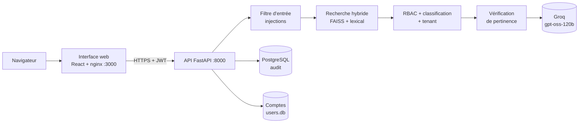

# Fluxa : assistant documentaire IA sécurisé (RAG)


Fluxa répond aux questions des collaborateurs d'une entreprise à partir de ses
propres documents, **en respectant qui a le droit de voir quoi**. Chaque réponse
cite ses sources, chaque accès est tracé, et une question hors périmètre ou
malveillante est refusée plutôt qu'inventée.

Ce dossier contient le **backend** (API, moteur RAG, sécurité, audit). L'interface
web est dans [`../frontend`](../frontend).

> Conçu et développé par **[Houda Mardas](#auteure)**, AI Engineer, pendant son stage
> chez Alexsys Solutions (Casablanca, 2026).

## Résultats clés

| | |
|---|---|
| Corpus indexé | ~3 000 passages, réponses avec citation des sources |
| Évaluation sur le vrai pipeline | 55 / 55 cas réussis au 21 octobre 2026 ([détail](docs/EVALUATION.md)) |
| Injections de prompt | 9 / 9 bloquées (français, anglais, arabe, darija) |
| Accès interdits (RBAC) | 7 / 7 refusés, 8 rôles métier |
| Tests automatisés | 229 tests, CI GitHub Actions avec analyse de secrets (gitleaks) |
| Déploiement | Docker, 3 environnements (dev, staging, prod), architecture Azure en 9 modules Bicep |

## Stack technique

- **IA / RAG** : sentence-transformers (embeddings), FAISS, recherche hybride vectorielle + lexicale, Groq (LLM), vérification de pertinence
- **Backend** : Python 3.11, FastAPI, Pydantic, JWT, traitement asynchrone
- **Données** : PostgreSQL (audit), SQLite (comptes), ingestion PDF / DOCX / XLSX / PPTX
- **DevOps** : Docker, Docker Compose, GitHub Actions, gitleaks, Azure Container Apps, Key Vault, Bicep
- **Frontend** ([`../frontend`](../frontend)) : React, TypeScript, Vite, Tailwind

## Ce que fait la plateforme

- **Recherche hybride** : index vectoriel FAISS + score lexical, puis une étape de
  vérification de pertinence avant toute génération.
- **Contrôle d'accès par rôle (RBAC)** : un profil ne reçoit que les passages que
  son rôle est autorisé à lire. Les passages interdits ne sont jamais envoyés au
  modèle.
- **Niveaux de classification** : Public, Interne, Confidentiel, Restreint. Ils
  s'affichent sur chaque source et sur chaque document.
- **Multi-tenant** : un passage appartient à un tenant ; seuls les textes
  réglementaires publics sont partagés entre tenants.
- **Filtre d'entrée** : détection des tentatives d'injection de prompt
  (français, anglais, arabe, darija) avant tout appel au modèle.
- **Analyse de fichiers** : un utilisateur peut joindre un document (jusqu'à 5 Mo),
  traité en mémoire pendant 30 minutes, jamais indexé.
- **Journal d'audit** dans PostgreSQL : question, rôle, mode de réponse, sources
  et niveau de classification, événements de téléversement.
- **Modes de réponse explicites** : `RAG`, `MULTI_INTENT`, `GENERAL`, `ABSENT`,
  `HORS_PERIMETRE`, `CLARIFICATION`, `BLOQUE`, `FICHIER`.

## Architecture



Le déploiement cible sur Azure (Container Apps, PostgreSQL, Key Vault, Bicep) est
décrit dans [docs/ARCHITECTURE_AZURE.md](docs/ARCHITECTURE_AZURE.md).

## Ce que contient ce dépôt public

Le code, les tests, le jeu d'évaluation, les modèles Bicep et la documentation sont inclus.
Le **corpus brut** (`data/raw/`), l'**index FAISS** (`data/index/`) et les bases de comptes
et d'audit ne le sont pas : l'index se reconstruit avec `build_index.py` à partir de vos
propres documents. Les mots de passe de démonstration ne sont jamais versionnés.

Ce projet a été réalisé par Houda Mardas dans le cadre d'un stage chez Alexsys Solutions.

## Démarrage rapide (Docker)

Prérequis : Docker Desktop, une clé API Groq.

```powershell
copy .env.example .env
# Renseigner GROQ_API_KEY et SECRET_KEY (32 caractères minimum) dans .env.
# Ne jamais commiter .env.

docker compose up -d --build
docker compose ps                      # api, web, postgres : "healthy"

# Créer un compte par rôle ; les mots de passe aléatoires s'affichent UNE fois.
docker compose exec api python create_user.py --demo
```

| Service | Adresse |
|---|---|
| Interface web | http://localhost:3000 |
| API | http://localhost:8000 |
| PostgreSQL | 127.0.0.1:15432 |
| pgAdmin | http://127.0.0.1:5050 |

L'index FAISS se reconstruit avec `build_index.py`.

## Comptes de démonstration

`create_user.py --demo` crée un compte `demo_<rôle>` par rôle, tous dans le tenant
`demo`. Les mots de passe ne sont jamais écrits dans le dépôt : ils sont affichés à
la création. Pour les renouveler : `python create_user.py --rotate-demo`. Pour
lister les comptes : `python create_user.py --list`.

| Compte | Rôle |
|---|---|
| `demo_direction` | direction |
| `demo_finance` | finance |
| `demo_rh` | rh |
| `demo_it` | it |
| `demo_juridique` | juridique |
| `demo_marketing` | marketing |
| `demo_commerce` | commerce |
| `demo_tous` | tous |

**Avant toute démonstration extérieure ou déploiement, renouveler ces mots de passe.**

## Configuration

Les variables sont documentées dans [docs/ENVIRONNEMENTS.md](docs/ENVIRONNEMENTS.md)
et listées sans valeur dans `.env.example`. Les principales :

| Variable | Rôle |
|---|---|
| `GROQ_API_KEY` | clé du fournisseur de modèle (secret) |
| `SECRET_KEY` | clé de signature des jetons (secret, 32 caractères minimum) |
| `PG_DSN` | connexion PostgreSQL de l'audit (secret) |
| `GROQ_MODEL`, `GROQ_VERIFY_MODEL` | modèles de génération et de vérification |
| `ENVIRONMENT`, `DEBUG` | environnement (`development`, `staging`, `production`) |
| `CORS_ORIGINS` | origines autorisées pour l'interface |
| `CORPUS_TENANT_ID` | tenant auquel appartient le corpus |
| `LLM_PRICE_IN_PER_M`, `LLM_PRICE_OUT_PER_M` | tarifs pour l'estimation des coûts |

## Tests et évaluation

```powershell
$env:GROQ_API_KEY = "gsk_" + ("x" * 40)   # clé factice : les tests ne contactent pas Groq
python -m pytest -q
```

Les tests rapides protègent contre les régressions (CI). La qualité du système est
mesurée séparément sur le **vrai pipeline, le vrai index et le vrai modèle** avec
un jeu de 55 cas (`data/eval/v1.json`) : réponses attendues, refus d'accès croisés,
injections, hors périmètre. Méthode, résultats par famille de questions et
limites : [docs/EVALUATION.md](docs/EVALUATION.md).

## Structure

| Dossier | Contenu |
|---|---|
| `app/` | API FastAPI : authentification, `/ask`, fichiers, corpus, administration, audit |
| `rag/` | moteur : recherche, RBAC, classification, tenants, vérification, filtre d'entrée, évaluation |
| `data/` | corpus, index FAISS, jeu d'évaluation |
| `scripts/` | import, matrices d'accès, diagnostics |
| `infra/` | modèles Bicep (dev, staging, prod), validés par compilation |
| `tests/` | tests automatisés |
| `docs/` | architecture Azure, environnements, évaluation, limites, démonstration |

## Documentation

- [Scénario de démonstration](docs/DEMO.md)
- [Évaluation du RAG](docs/EVALUATION.md)
- [Environnements dev / staging / prod](docs/ENVIRONNEMENTS.md)
- [Architecture Azure](docs/ARCHITECTURE_AZURE.md)
- [Limites connues](docs/LIMITES.md)

## Limites à connaître

Le détail complet est dans [docs/LIMITES.md](docs/LIMITES.md). Les plus importantes :

- **Quota du fournisseur de modèle.** Sur l'offre gratuite de Groq, une question
  consomme environ 5 000 à 10 000 tokens et le plafond par minute est atteint dès la
  deuxième ou troisième question enchaînée : les réponses ralentissent alors de
  plusieurs dizaines de secondes. Une démonstration fiable demande l'offre payante.
- **Déploiement Azure non exécuté.** Les modèles Bicep compilent et sont documentés,
  mais aucun déploiement réel n'a été fait.
- **Corpus de démonstration.** Les documents internes (RH, Finance, Marketing,
  Commerce, Juridique) sont synthétiques ; les textes réglementaires et les rapports
  d'entreprises sont publics.

## Sécurité

- Aucun secret dans le dépôt : `.env` est ignoré, une analyse de secrets (gitleaks)
  tourne en CI.
- Mots de passe de démonstration aléatoires, à renouveler avant tout partage.
- Les passages interdits à un rôle ne sont jamais transmis au modèle.
- Les fichiers téléversés restent en mémoire et expirent après 30 minutes.

## Auteure

**Houda Mardas** · AI Engineer (IA générative, RAG, agents IA) · Ingénieure d'État en
Génie Informatique & IA (HESTIM, Casablanca)

J'ai conçu et développé Fluxa de bout en bout : moteur RAG et recherche hybride,
contrôle d'accès et filtre anti-injection, API FastAPI, jeu d'évaluation, tests et CI,
conteneurisation et architecture Azure, ainsi que l'interface web React.

- GitHub : [@houdamardas1](https://github.com/houdamardas1)
- LinkedIn : [houda-m-567987243](https://www.linkedin.com/in/houda-m-567987243)
- Portfolio : [portfoliohouda-mardas.netlify.app](https://portfoliohouda-mardas.netlify.app)
