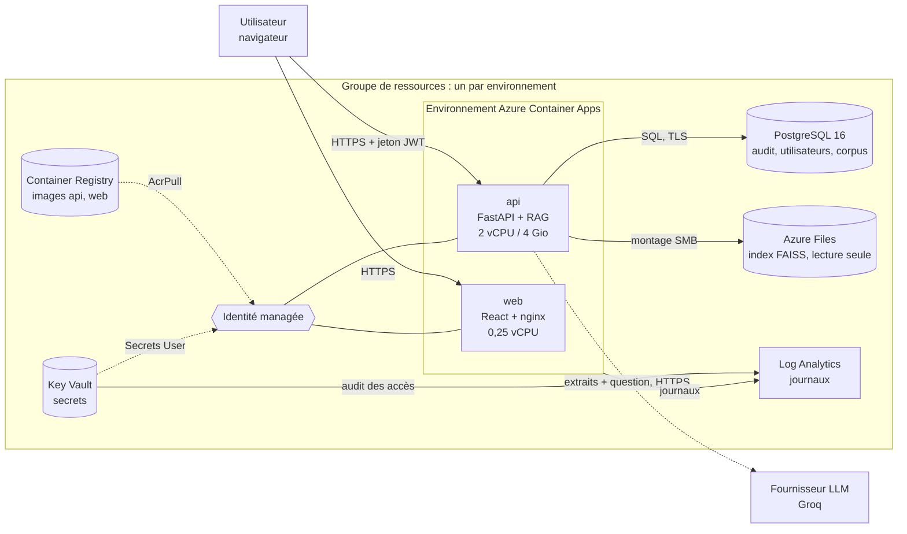

# Architecture de production sur Azure

Ce document décrit comment Fluxa Intelligence se déploie sur Microsoft Azure, pourquoi chaque choix a été fait, et ce qui a été réellement vérifié.

**Statut de validation.** L'infrastructure est décrite en Bicep (`infra/`). Chaque fichier a été **compilé et analysé** avec le compilateur Bicep 0.48.1 (`bicep build`, `bicep lint`, `bicep build-params`) : zéro erreur, zéro avertissement. Elle n'a **pas été déployée** (aucun abonnement Azure n'a été utilisé) : les noms de ressources, les droits et les quotas de l'abonnement ne sont donc pas confirmés par un déploiement réel (voir « Limites »).

## 1. Vue d'ensemble



Le navigateur appelle l'API directement (l'adresse de l'API est intégrée à l'interface au moment de sa construction) : l'API déclare donc l'adresse de l'interface dans sa liste CORS.

## 2. Correspondance avec l'existant

| Aujourd'hui (Docker Compose) | Sur Azure | Remarque |
|---|---|---|
| `api` (FastAPI, torch CPU, modèle d'embeddings dans l'image) | Container App `api` | 2 vCPU / 4 Gio en staging et production, comme les surcouches Docker ; démarrage d'environ 1 min, d'où une sonde de démarrage de près de 4 min |
| `web` (nginx sans root, port 8080) | Container App `web` | Même image |
| `postgres:16-alpine` | PostgreSQL Flexible Server 16 | Sauvegardes automatiques, haute disponibilité en production |
| `pgadmin` | Non déployé | Outil de développement ; accès par client SQL ou Azure Cloud Shell |
| Volume `./data/index` en lecture seule | Partage Azure Files monté en lecture seule | Fichiers en mode 0444, utilisateur 1000 comme le conteneur |
| `.env` de la machine | Key Vault + variables de l'application | Aucun secret dans Git ni dans le modèle |
| Réseau Docker | Réseau virtuel privé (production) | PostgreSQL sans adresse publique |
| `docker compose logs` | Log Analytics | Rétention 30 jours (dev, staging), 90 jours (production) |

## 3. Décisions d'architecture

### 3.1 Calcul : Azure Container Apps (et non App Service ni Kubernetes)

- Les images existent déjà et ne changent pas : Container Apps exécute des conteneurs sans cluster à administrer.
- Mise à l'échelle sur la charge HTTP et révisions : adapté à une application dont la charge est irrégulière.
- Kubernetes (AKS) apporterait un contrôle inutile à cette échelle et un coût d'exploitation élevé.
- **Sessions collantes.** Les fichiers téléversés pour analyse et les limiteurs de débit sont **en mémoire, par réplique** (limite documentée dans `LIMITES.md`). L'entrée de l'API garde donc chaque utilisateur sur la même réplique. Ce n'est qu'un palliatif : un redémarrage ou une montée en charge perd les fichiers en cours (ils sont éphémères par conception, 30 min).
- **Au moins une réplique** en staging et production : un démarrage à froid dure environ une minute. En dev, la mise à zéro est autorisée pour réduire le coût, avec ce délai à la première requête.

### 3.2 Recherche : index FAISS sur Azure Files, Azure AI Search en évolution

| Critère | FAISS dans l'API (retenu) | Azure AI Search |
|---|---|---|
| Volume actuel (≈ 3 000 passages, 31 Mo) | Largement suffisant, chargé en mémoire | Surdimensionné |
| Coût | Inclus dans l'API | Environ 70 à 80 € / mois (niveau de base) au minimum |
| Latence de recherche | Quelques millisecondes, en mémoire | Appel réseau en plus |
| Recherche hybride (lexical + vectoriel) | Déjà implémentée et évaluée (`rag/retrieval.py`) | Native, avec reclassement sémantique |
| Filtrage de sécurité (rôle, classification, tenant) | Appliqué dans le code, vérifié par 223 tests | À réécrire en filtres d'index ; il faut stocker rôle, niveau et tenant par passage |
| Mise à jour de l'index | Reconstruction puis téléversement du dossier | Indexeurs et mises à jour incrémentales |
| Plusieurs répliques | Chaque réplique charge l'index (31 Mo) : sans problème | Un seul service partagé |

**Décision.** On garde FAISS : il fonctionne, il est évalué, et les règles d'accès (classification, tenant) sont déjà codées et testées autour de lui. Migrer maintenant ferait réécrire et réévaluer la couche la plus sensible pour un gain nul à cette taille.
**Seuil de bascule** vers Azure AI Search : corpus au-delà d'environ 100 000 passages, plusieurs clients ayant des corpus distincts (un index par tenant, ou filtre de sécurité par tenant), ou besoin de mises à jour fréquentes. La migration porterait sur `rag/retrieval.py` et `rag/rbac.py` ; l'évaluation de 55 cas permettrait de mesurer l'absence de régression.

### 3.3 Base de données : PostgreSQL managé

Audit, utilisateurs et corpus sont déjà sur PostgreSQL (variable `PG_DSN`). Le service managé apporte sauvegardes automatiques avec restauration à un instant donné, mises à jour de sécurité, et haute disponibilité inter-zones en production. Le mode SQLite de repli reste disponible en développement local.

### 3.4 Secrets et identités

- Trois secrets dans Key Vault : clé de signature des jetons, clé du fournisseur LLM, chaîne de connexion PostgreSQL.
- Les applications les lisent avec une **identité managée** (rôle « Key Vault Secrets User ») : aucun mot de passe de service à distribuer ni à renouveler.
- Le registre n'a **pas de compte administrateur** ; l'identité tire les images avec le rôle AcrPull.
- Le Key Vault journalise chaque accès (catégorie d'audit) vers Log Analytics. En production, la protection contre la purge est activée (irréversible).
- Les secrets du déploiement passent par des **variables d'environnement** de la session de l'opérateur ; ils ne figurent dans aucun fichier du dépôt.

### 3.5 Réseau

- **Production** : réseau virtuel dédié, l'environnement de conteneurs et PostgreSQL y sont délégués ; PostgreSQL n'a **aucun accès public** (zone DNS privée).
- **Dev et staging** : PostgreSQL est joignable publiquement mais **seulement par les services Azure** (règle de pare-feu 0.0.0.0), avec TLS obligatoire. C'est un compromis de coût et de simplicité, accepté pour des environnements sans données réelles.
- Non traité (voir §7) : points d'accès privés pour le Key Vault, le registre et le stockage ; pare-feu applicatif.

### 3.6 Région et données

La région proposée est **France Centre** : Union européenne, offre complète de services, proche du Maroc (à ma connaissance Azure n'a pas de région au Maroc : à vérifier au moment du déploiement). Les données hébergées (base, index, journaux) y restent.
**Point de vigilance conformité :** la question de l'utilisateur et les extraits retenus sont envoyés au **fournisseur LLM (Groq), hors d'Azure** ; les images téléversées pour analyse le sont aussi. Pour un déploiement exigeant une maîtrise stricte des transferts (loi marocaine 09-08, CNDP), l'alternative est **Azure OpenAI dans la même région** : cela demande de remplacer le client dans `rag/llm.py` et de réévaluer le jeu de 55 cas. Ce changement n'est pas fait.

## 4. Environnements

Le dimensionnement est dans la variable `profils` de `infra/main.bicep` ; le profil se choisit par le fichier de paramètres.

| | dev | staging | production |
|---|---|---|---|
| Valeur de `ENVIRONMENT` de l'API | development | staging | production |
| API | 1 vCPU / 2 Gio, 0 à 1 réplique | 2 vCPU / 4 Gio, 1 à 2 répliques | 2 vCPU / 4 Gio, 1 à 3 répliques |
| Interface | 0 à 3 répliques | 1 à 3 | 1 à 3 |
| PostgreSQL | Burstable B1ms, 32 Go | Burstable B2s, 32 Go | D2ds v5 (usage général), 64 Go |
| Haute disponibilité de la base | non | non | inter-zones |
| Rétention des sauvegardes | 7 jours | 7 jours | 35 jours |
| Réseau privé | non | non | oui |
| Registre | Basic | Basic | Standard |
| Stockage de l'index | LRS | LRS | ZRS (redondance inter-zones) |
| Rétention des journaux | 30 jours | 30 jours | 90 jours |
| Key Vault : suppression récupérable | 7 jours | 30 jours | 90 jours + protection contre la purge |

## 5. Estimation de coût (ordre de grandeur)

Estimations **indicatives**, en euros par mois, hors coût du fournisseur LLM (facturé aux tokens). Elles reposent sur des tarifs publics de mémoire et supposent une API au repos la majeure partie du temps ; elles sont à **confirmer avec la calculatrice de prix Azure** avant tout engagement.

| Environnement | Principaux postes | Ordre de grandeur |
|---|---|---|
| dev | PostgreSQL B1ms, registre Basic, API qui s'éteint | 25 à 40 € |
| staging | PostgreSQL B2s, API toujours allumée (2 vCPU / 4 Gio), registre | 110 à 160 € |
| production | PostgreSQL à haute disponibilité (poste principal), API 1 à 3 répliques, registre Standard, journaux 90 jours | 350 à 550 € |

Une partie de la consommation des conteneurs est couverte par une franchise mensuelle gratuite par abonnement.

## 6. Procédure de déploiement

> Ces commandes n'ont pas été exécutées (pas d'abonnement). À dérouler d'abord en **dev**, avec `az deployment group what-if` avant chaque déploiement.

**Prérequis :** Azure CLI avec Bicep (`az bicep install`), un abonnement, et le droit de créer des ressources et des attributions de rôle (rôle Propriétaire ou Contributeur + Administrateur de l'accès utilisateur) sur le groupe.

**0. Secrets de session** (PowerShell, depuis `backend\`) : rien n'est affiché.

```powershell
$env:FLUXA_PG_PASSWORD = -join ((48..57 + 65..90 + 97..122) | Get-Random -Count 32 | ForEach-Object { [char]$_ })
$env:FLUXA_SECRET_KEY  = -join ((48..57 + 65..90 + 97..122) | Get-Random -Count 48 | ForEach-Object { [char]$_ })
$env:FLUXA_GROQ_API_KEY = (Select-String -Path .env -Pattern '^GROQ_API_KEY=').Line.Split('=', 2)[1]
```

**1. Phase 1 : infrastructure seule**

```powershell
az login
az account set --subscription "<ID de l'abonnement>"
az group create -n rg-fluxa-dev -l francecentral
az deployment group what-if -g rg-fluxa-dev --parameters infra/parameters/dev.bicepparam
az deployment group create  -g rg-fluxa-dev --parameters infra/parameters/dev.bicepparam --query properties.outputs
```

Notez les sorties `registryName`, `storageAccountName`, `environmentDomain`.

**2. Images et index**

```powershell
$acr = "<registryName>"; $sa = "<storageAccountName>"; $domaine = "<environmentDomain>"
az acr build -r $acr -t fluxa-api:latest -f Dockerfile .
az acr build -r $acr -t fluxa-web:latest -f ..\frontend\Dockerfile `
   --build-arg VITE_API_URL=https://fluxa-dev-api.$domaine ..\frontend
$cle = az storage account keys list -n $sa -g rg-fluxa-dev --query "[0].value" -o tsv
az storage file upload-batch --account-name $sa --account-key $cle -d faiss-index -s data\index
```

**3. Phase 2 : applications**

```powershell
$env:FLUXA_DEPLOY_APPS = "true"
az deployment group create -g rg-fluxa-dev --parameters infra/parameters/dev.bicepparam --query properties.outputs.webUrl
```

Si la première création des applications échoue sur la lecture d'un secret, c'est le délai de propagation du rôle sur le Key Vault : relancer la même commande.

**4. Base vide.** Créer les utilisateurs : `az containerapp exec -g rg-fluxa-dev -n fluxa-dev-api --command "python create_user.py ..."`. L'import des jeux de données (`scripts/import_datasets_pg.py`) vise `127.0.0.1:15432` en dur et le dossier `scripts/` n'est pas dans l'image : il faut l'adapter (adresse du serveur, exécution depuis une machine du réseau en production). Ce point est ouvert.

**5. Production.** Mêmes étapes avec `prod.bicepparam` et `rg-fluxa-prod`. Les secrets de production sont générés à part et jamais réutilisés d'un autre environnement.

## 7. Limites et travail restant

**Non vérifié (validation par compilation uniquement).**
- Aucun déploiement réel : les noms globaux (registre, stockage, coffre, serveur), les quotas de l'abonnement dans la région, la disponibilité des tailles de base de données et la propagation des rôles restent à confirmer au premier déploiement.
- Le montage Azure Files et les droits du fichier pour l'utilisateur 1000 sont écrits d'après la documentation, non testés.
- `ENVIRONMENT` est une chaîne libre : seule la valeur `development` assouplit le contrôle de la clé de signature (avertissement au lieu d'un refus de démarrer). Les trois valeurs utilisées sont acceptées ; hors `development`, une clé jugée faible empêche le démarrage. La clé générée par la procédure (48 caractères aléatoires) devrait passer, ce qui reste à confirmer au premier démarrage.
- Dimensionnement de l'API de dev (1 vCPU / 2 Gio) : mesuré en local avec ces limites (conteneur sain en moins de 2 minutes, 1 023 Mio au repos, aucun arrêt par manque de mémoire). La charge (questions, analyse de fichiers lourds) n'a pas été mesurée : la marge est d'environ 1 Gio, à surveiller ; en cas d'arrêt par manque de mémoire, passer le profil dev à 2 vCPU / 4 Gio.
- Les coûts sont des estimations.

**Non traité.**
- Pare-feu applicatif et répartiteur global (Front Door, WAF), nom de domaine et certificat personnalisés.
- Points d'accès privés pour le Key Vault, le registre et le stockage.
- Authentification d'entreprise (Entra ID, SSO) : l'authentification actuelle est locale (jetons signés par l'API).
- Déploiement continu (pipeline de publication) : la CI actuelle exécute les tests, l'analyse des secrets et la construction des images, sans publier.
- Alertes et tableau de bord Azure (la supervision applicative reste le tableau de bord de Fluxa).
- État partagé entre répliques : fichiers téléversés et limiteurs de débit en mémoire (sessions collantes en palliatif) ; un cache partagé (Redis) serait nécessaire pour une vraie montée en charge.
- Test de restauration des sauvegardes et plan de reprise d'activité.
- Quota du fournisseur LLM : 200 000 tokens par jour au palier gratuit actuel, insuffisant pour une exploitation réelle (`LIMITES.md`, §28).

## 8. Contenu du dossier `infra/`

```
infra/
├── main.bicep                  assemble les modules ; profils dev / staging / prod
├── modules/
│   ├── monitoring.bicep        Log Analytics
│   ├── identity.bicep          identité managée
│   ├── network.bicep           réseau virtuel, sous-réseaux délégués, DNS privé (production)
│   ├── registry.bicep          registre d'images + rôle AcrPull
│   ├── postgres.bicep          PostgreSQL 16, base, pare-feu ou accès privé
│   ├── keyvault.bicep          coffre, 3 secrets, rôle de lecture, journal d'audit
│   ├── storage.bicep           compte de stockage + partage de l'index
│   ├── containerenv.bicep      environnement de conteneurs + montage de l'index
│   └── apps.bicep              applications api et web (phase 2)
└── parameters/
    ├── dev.bicepparam
    ├── staging.bicepparam
    └── prod.bicepparam
```

Vérification locale, sans Azure :

```powershell
$env:FLUXA_PG_PASSWORD = "Factice-Mdp-1234567890"; $env:FLUXA_SECRET_KEY = "k" * 40; $env:FLUXA_GROQ_API_KEY = "gsk_" + ("x" * 40)
bicep lint infra/main.bicep
bicep build infra/main.bicep --stdout > $null
bicep build-params infra/parameters/prod.bicepparam --stdout > $null
```

Sans variables de secrets, la compilation des paramètres échoue volontairement : on ne déploie jamais avec un secret absent.
